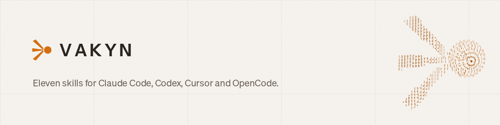

# VAKYN skills

For Claude Code, Codex, Cursor and OpenCode.

Find the decisions a chat model makes in your app, move them to VAKYN, and check the result on
your own data before you switch.

[](https://github.com/vakyn-ai/skills/actions/workflows/test.yml)
[](LICENSE)

VAKYN is a decision model. You send it a document and typed questions. It answers each one with
a probability:

```
ticket: "I was charged twice this month and need one refunded."

Which team should get it?        choice → billing   1.00
Does it ask for a refund?        noul   → yes       1.00
How soon does it need a reply?   score  → today     0.64   (can wait 0.12 · within the hour 0.24)
```

These eleven skills teach your coding agent to build with it.

## Install (30 seconds)

```bash
claude plugin marketplace add vakyn-ai/skills
claude plugin install vakyn@vakyn-ai
```

Run `/reload-plugins` in an open session, or start a new one.

Codex, Cursor or OpenCode, from your project folder:

```bash
npx skills add vakyn-ai/skills --skill '*' -a codex -a cursor -a opencode
```

## Get a key

The skills call VAKYN Cloud, the hosted API at `https://api.vakyn.com`. There is nothing to
install or run.

1. Sign in at [vakyn.com/console](https://vakyn.com/console) with Google, GitHub or X.
2. Add a balance under [Billing](https://vakyn.com/console/billing), or redeem a code. You pay per
   input token; output is free and errors cost nothing. Prices: [vakyn.com/docs/models](https://vakyn.com/docs/models).
3. Create a key under [API keys](https://vakyn.com/console/keys). It starts with `vk_` and is shown once.

Put it in your environment, or in a git-ignored `.env` file:

```bash
export VAKYN_API_KEY=vk_...
export VAKYN_BASE_URL=https://api.vakyn.com
# the official TypeSafe SDKs, used in generated code, read their own names:
export TYPESAFE_API_KEY=vk_...
export TYPESAFE_BASE_URL=https://api.vakyn.com
```

Not sure where to start? Ask your agent `I want to try VAKYN, what do I do?` and the `start`
skill walks you through it. More in the [quickstart](https://vakyn.com/docs/quickstart).

## Run it on your own servers

When your data can't leave your network, run the open models with the free
open-server: your servers, your country, your rules.
It serves the same API, so switching is one line: the base URL and the key. Ask your agent
`Set up VAKYN on our own server` (the `start` skill picks the model file for your hardware), or
read [vakyn.com/docs/self-hosting](https://vakyn.com/docs/self-hosting).

## Try it

Ask in plain words. Your agent picks the skill.

```
Where could VAKYN help in this repo?
Make VAKYN pick the tool in agent.py.
Build a router for our returns emails.
Why did it pick billing for this message?
Here's a week of side-by-side logs. Can we switch?
Label the 40,000 rows in reviews.csv by topic and sentiment.
Grade our support bot's replies with this rubric and gate the CI on it.
```

Or call one directly: `/vakyn:convert`.

A real run on a small helpdesk app (Python, OpenAI SDK), trimmed:

```
> Where could VAKYN help in this repo?

The report is in vakyn-research.md. I didn't change any code or make any calls.

Top 3 places VAKYN could help:
1. Ticket routing (helpdesk/triage.py:28): picks one of 4 teams with gpt-4o, about
   2,000 times a day. The team list already exists and a wrong pick is cheap to fix.
2. Spam check (helpdesk/triage.py:23): a yes/no question on all ~3,000 emails a day.
   Only mark spam when VAKYN is confident.
3. Urgency rating (helpdesk/triage.py:39): a 1–5 score that decides whether someone
   gets paged. High risk, so run it alongside gpt-4o first.

Stays with the chat model: the draft reply (replies.py:12) and the weekly summary.

Next: run the convert skill on the routing spot, then test it with the check skill on about
30 past tickets.
```

## The skills

| | Skill | What it does |
|---|---|---|
| **Start** | `start` | Checks if VAKYN fits, gets you a VAKYN Cloud key (or sets up your own server), makes a first call. |
| **Find** | `research` | Finds the decisions in your app or process and ranks them in `vakyn-research.md`. Changes nothing. |
| **Build** | `questions` | Picks `noul`, `choice` or `score`, writes options and levels, fixes a bad answer. |
| | `convert` | Turns a prompt or a tool list (OpenAI, Anthropic, MCP) into VAKYN calls and Python or TypeScript code. |
| | `workflow` | Designs a new decision workflow: route, triage, pick a tool, check a claim, rate with a rubric, pick the best match, spot risk, guard an agent's calls, fill a form, and more. |
| | `cascade` | A cheap chat model drafts, VAKYN checks the draft against its sources, only failed drafts go to the expensive model. |
| | `judge` | Grades chat-model or agent outputs against your rubric, aligns it with your experts, runs in CI. |
| | `batch` | Runs a CSV, Parquet or SQL table through VAKYN: pilot, resume, progress, answer columns, a review file for unsure rows. |
| | `distill` | Turns an agent that repeats a written procedure into a program of code, VAKYN questions and small agent steps, and moves traffic to it in stages. |
| | `migrate` | Moves code from other decision APIs to VAKYN Cloud (or your own server) and points framework adapters at it. |
| **Prove** | `check` | Tests against your chat model on 30 records, reads side-by-side logs, sets thresholds, checks calibration and drift, reviews before go-live. |

A typical path:

1. `research` finds where VAKYN fits.
2. `convert`, `workflow`, `cascade` or `judge` builds it; `batch` runs it over what you already have.
3. `check` proves it on your data before you switch, and again after every change.

## What the skills always do

- **Check every request before it is sent:** right shapes, limits, described options, an escape
  option such as `other` or `none`, one question per proposition.
- **Keep exact work in code.** Arithmetic, dates, thresholds and rules stay in your code. VAKYN
  answers the judgment.
- **Give unsure answers a path:** a person, a chat model, or a review queue.
- **Run side by side first.** A converted app keeps using your chat model and logs both answers
  until you switch.
- **Ask before spending.** Before a run of more than a handful of requests on VAKYN Cloud, the agent
  estimates the cost from the live prices in `GET /v1/models` and waits for your yes.
- **Never invent answers.** If VAKYN is not reachable, the agent says so and still writes the
  request and the code.
- **Keep your key out of the chat.** It lives in `VAKYN_API_KEY` (or `TYPESAFE_API_KEY` for the
  official SDKs).

Generated code uses the official TypeSafe SDKs (`typesafe-sdk`, `@typesafe-ai/sdk`). They work
with VAKYN's Jev-compatible API once their base URL points at VAKYN Cloud or your own server.
API details: [vakyn.com/docs/api](https://vakyn.com/docs/api).

## How we test it

- **Graded runs.** Each skill has cases that run Claude Code headless with the plugin on a real
  request, such as "convert this triage prompt" or "find the decisions in this app", and a grader
  scores the result. See [evals/](evals/README.md).
- **Real answers.** Every request the skills write during those runs, and every example request
  in this repo, passes the pre-send checklist and is sent to a running VAKYN server.
- **Every push** runs offline checks on manifests, skills, links, wording and example requests.

## What you need

- Claude Code, Codex, Cursor or OpenCode.
- A VAKYN Cloud API key ([get one](#get-a-key)). Or your own
  open-server ([self-hosting docs](https://vakyn.com/docs/self-hosting)) with a model file and a key; the `start`
  skill sets it up.

<details>
<summary><strong>Update</strong></summary>

Installed plugins update in the background when a new version is released. To update now:

```bash
claude plugin marketplace update vakyn-ai
claude plugin update vakyn@vakyn-ai
```

</details>

<details>
<summary><strong>Other coding agents: details</strong></summary>

The skills land in `.agents/skills/`, which Codex, Cursor and OpenCode all read. Add `-g` for
every project. Install all of them: they link to each other. Their folder names are short (`start`, `check`, `convert`…); if another skill already uses one of those names, install into a separate project or rename it there. Update with `npx skills update -y`,
remove with `npx skills remove --all`. Details: [docs/install-other-agents.md](docs/install-other-agents.md).
Want another agent? Open an issue and say which.

</details>

<details>
<summary><strong>Develop</strong></summary>

```bash
claude --plugin-dir .                     # try the plugin from this folder
make test                                 # offline: manifests, skills, links, voice, example requests
VAKYN_API_KEY=... make test-live          # send every example request to VAKYN_BASE_URL (default: a local open-server)
VAKYN_API_KEY=... make eval TAG=start     # headless Claude Code runs per skill, graded
make release VERSION=x.y.z                # validate, bump, tag, push
```

`make eval` uses your Claude account (about $0.15–0.40 per case).

</details>

## License

MIT
